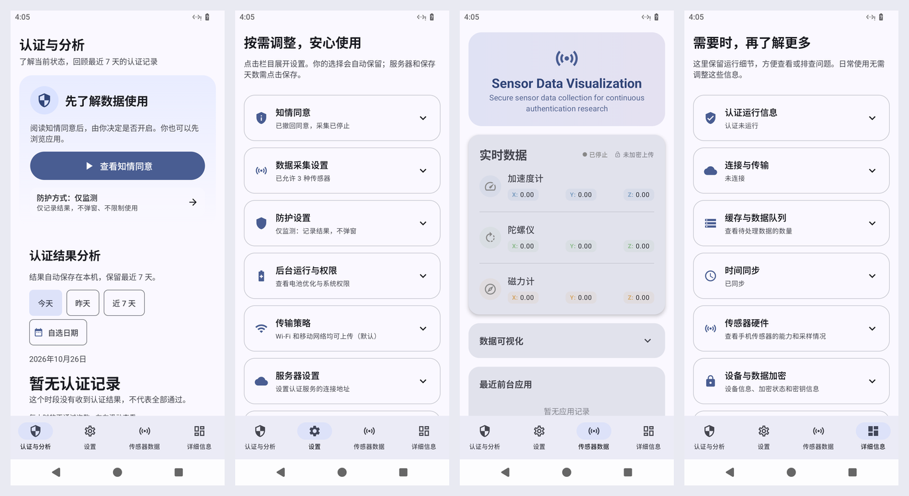

# 面向普通用户的持续身份认证界面改造



## 交互设计

底部导航按「认证与分析 → 设置 → 传感器数据 → 详细信息」排列，入口名称常显，首次进入认证页。传感器页面保持任务开始时的实现，仅调整入口顺序。

认证页把开始/停止、当前状态和最近七天结果放在主要位置。一键开始会准备数据采集和服务器连接，不要求用户先理解上传管道。准备过程可取消；没有收到结果不能显示为认证通过。页面使用普通中文说明异常可能受姿势和环境影响，不将一次不通过直接解释为他人使用。

统计按今天、昨天、近七天或自选日期查看。不通过次数以柱状图显示，单日按小时、多日按日，选择柱子可查看该时段涉及的应用及发生时刻。同名不同包名的应用分开统计；无使用情况权限或不能准确识别时显示「未识别的应用」。日期依据手机本地时区，并处理夏令时的23/25小时日期。

设置分为知情同意、数据采集设置、防护设置、后台运行与权限、传输策略、服务器设置、数据与存储、维护工具。所有栏目初次访问默认收起，点标题展开，内部开关不会触发折叠。详细信息采用同一交互，分类保存原有技术信息。

首次自动展示知情同意；暂不启用后可继续浏览，采集与认证仍需明确同意。设置中可重新查看、同意和撤回。撤回会停止运行，清除本机认证历史及采集数据。服务端目前没有自动删除接口，界面会明确提示联系服务器管理方处理已上传的数据，本机仅保留待处理状态。首次提示与授权状态分别存储。

三种传感器可独立选择，全部关闭时停止采集。防护默认「仅监测」：记录结果，不自动弹窗；「关闭」停止认证；「即时警示」通过系统浮窗提示不通过，需要用户授予在其他应用上方显示权限。切换设置不自动开始认证。仅Wi-Fi上传默认关闭。

服务器及缓存天数在保存前校验。维护导出使用系统文件保存界面，用户可以直接选择位置。原密钥维护操作仅更新维护标记，不将它描述成实际替换加密密钥。

## 实现与兼容性

- compileSdk / targetSdk 36（Android 16），minSdk 30；版本 1.1.0。
- AGP 8.11.1、Gradle 8.13、JDK 17；保留 Jetpack Compose / Material 3。
- 安装包支持 arm64-v8a / x86_64，与 MMKV 依赖实际提供的架构一致；原生库 ELF 段及 APK 内未压缩库的位置按 16KB 对齐。
- 认证结果由独立单例处理，服务在后台时仍记录；校验启动状态、设备、会话及结果窗口并去重。
- SQLite 独立保存近七天结果，定期清理；认证历史和活动认证状态不参与系统备份。
- 停止/撤回使用状态检查避免迟到结果继续记录或告警；单个设置项持久化保存。
- 页面支持系统深浅色、较大字体、滚动、48dp以上主要点击区域、折叠状态语义和柱图文字说明。

## 验证记录

测试按数据行为、页面交互和设备运行三层执行：

| 验证范围 | 主要用例 |
| --- | --- |
| 认证与分析 | 未同意、关闭、准备/取消、开始/停止、仅监测被动提示、即时警示说明、无数据与全通过区分 |
| 七天统计 | 去重、过期清理、重开恢复、跨午夜/时区/夏令时、日期范围、小时柱选择、应用和时刻关联 |
| 设置 | 八组默认折叠、展开/收起、恢复状态、内部开关、防护单选、三传感器持久化、Wi-Fi默认值 |
| 详细信息/传感器 | 详情11组逐一展开、旧传感器图展开/收起、导航顺序与名称 |
| 用户授权 | 首次弹窗、拒绝后浏览、重建不重复弹、重新查看、授权与已读分离、撤回后迟到结果 |
| 输入/导出 | 服务器地址与端口、缓存天数、危险操作二次确认、ZIP/TXT实际保存、失败/取消反馈 |
| 防护/后台 | 会话与设备校验、重复窗口、关闭后不记录、不弹窗、停止后轮换会话、锁屏暂停保持 |
| 可访问性 | 放大字体、窄屏、主要点击区域、折叠语义、柱图文字等价 |

构建与主机测试命令：

```bash
./gradlew :app:testDebugUnitTest :app:assembleDebug \
  :app:assembleDebugAndroidTest :app:assembleRelease :app:lintDebug \
  -PuiRedesignTestsOnly=true --console=plain --max-workers=2
```

设备测试使用独立 Android 16 测试设备，执行以下命令（主机为 ARM64，使用 `/usr/bin/adb`）：

```bash
/usr/bin/adb -s 127.0.0.1:5562 install -r app/build/outputs/apk/debug/app-debug.apk
/usr/bin/adb -s 127.0.0.1:5562 install -r app/build/outputs/apk/androidTest/debug/app-debug-androidTest.apk
/usr/bin/adb -s 127.0.0.1:5562 shell am instrument -w -r \
  com.continuousauth.test/androidx.test.runner.AndroidJUnitRunner
```

`uiRedesignTestsOnly` 包含本次界面测试和当前后台上传 SQLite 回归用例。仓库旧 `src/androidTest` 中仍有引用已删除传输接口的历史用例，不计入本次通过数量。真实数据库持久化、过期清理和撤回删除均在 Android 16 执行，没有用模拟数据库替代。

最终统一测试结果：

| 检查 | 结果 |
| --- | --- |
| 主机单元测试 | 28 个测试套件、197 项全部通过；0 失败、0 跳过 |
| Android 16 设备测试 | 45 项全部通过；含真实 SQLite、系统浮窗、授权撤回再同意及横屏大字号 |
| Android Lint | 0 错误；392 条 warning、7 条 hint，保留完整报告以便后续处理 |
| 视觉巡检 | 四页、折叠展开、深浅色、两倍字号、横屏；知情同意正文可滚动且双按钮可操作 |
| 原生库与安装包对齐 | 两种 64 位 ABI 的 6 个原生库，ELF 与 APK 内数据偏移均满足 16KB 对齐；未使用 16KB 内核设备实测 |

主机测试报告位于 `app/build/reports/tests/testDebugUnitTest/index.html`，Lint 报告位于 `app/build/reports/lint-results-debug.html`。设备完整结果保存在 `app/build/reports/ui-redesign/instrumentation-delivery.log`，实际截图在同一目录。认证分析用例中的受控认证结果仅用于客户端交互验证。

验收发现并修复了两类仅靠编译不能发现的问题：横屏大字号下知情同意按钮被固定标题挤压，以及 Release 压缩移除 LZ4 反射实现导致的启动异常。前者新增了竖屏和大字号短屏用例；后者通过安装并运行实际压缩 APK 验证。

Release 实际安装验收通过：冷启动、首次提示、四个页面切换、设置与详情展开/收起均可操作，检查期间无新增崩溃。日志为 `app/build/reports/ui-redesign/release-smoke.log`。LZ4 修复仅调整压缩规则，随后重新执行 `:app:assembleRelease :app:lintDebug`，构建成功；Debug 的 197 项主机测试与 45 项设备用例对应的源码保持一致。

## APK 交付

版本为 **1.1.0（versionCode 4）**，目标 Android 16 / API 36，支持 arm64-v8a、x86_64。

- **可直接安装的压缩版本**：`app/build/outputs/apk/release/app-release-test-signed.apk`，15,175,924 字节。使用本机已有 Android debug key 测试签名，APK Signature Scheme v3 验证通过；此包为 Release 构建、非 debuggable，正式分发时应改用自己的发布签名。
- **调试版本**：`app/build/outputs/apk/debug/app-debug.apk`，用于完整设备自动化测试，签名验证通过。
- `app-release-unsigned.apk` 是构建产生的未签名中间产物，不能直接安装。

SHA-256：

```text
app-release-test-signed.apk
b020d93a0da8656f4dfaf826baa54656545874e0248562af8b7be30a8bba2e0e

app-debug.apk
670604dadf6c75b036680fb1d6ad89976552b676b534cf95ff9b16006a8fd13b
```

签名后的最终 Release 再次核验了全部 6 个原生库，ELF 与 APK 内位置仍满足 16KB 对齐。安装验证使用 `adb install --no-incremental -r`，避免测试容器不支持增量安装带来的回退提示。

## 已知服务端边界

当前协议有开始认证接口，没有停止认证接口。客户端停止时会使本地认证状态失效并轮换采集会话，后续采集不再主动开始认证，旧会话迟到结果不会统计或提醒；已经上传到服务器的旧数据能否立即停止处理，取决于服务端实现。

当前服务器数据删除接口尚未实现，界面如实显示远端删除待处理，不宣称已经删除服务器数据。测试中受控注入的结果用于验证客户端统计、持久化和警示行为，不代表已验证生产模型识别准确率。


## Android 16 设备测试环境

使用独立 redroid Android 16 / API 36 ARM64 容器，1080×2400、440dpi。当前宿主机为Linux 5.15，原容器镜像在其上无法启动：软件图形缓存预热失败，且memfd缺少新增ashmem ioctl。测试时仅对专用容器关闭shader预热，并修补system/vendor libcutils各4字节，允许使用已有memfd功能；没有改动应用代码、APK、主机内核及其他容器。界面和权限测试在启动完成的Android16 framework实际执行。

该环境没有物理传感器。设备测试能验证Android16应用启动、交互、系统权限、真实SQLite及浮窗，不能代替实体手机的动作识别准确率、厂商后台策略、真实功耗、连续一周运行或不同硬件兼容性验收。
