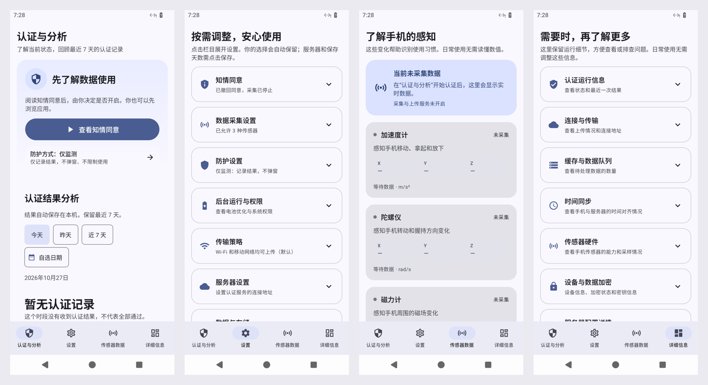

# 持续身份认证 App：性能、连接修复与验证记录

日期：2026-10-27。应用版本：`1.1.1`（`versionCode=5`）。目标平台：Android 16 / API 36，最低支持 Android 11 / API 30，仅提供 `arm64-v8a`、`x86_64` 两种 ABI。

本轮已修复界面高频刷新、主线程阻塞、连接状态误判、服务器切换竞态，以及缓冲、持久化和生命周期中的已确认问题。真实只读检查同时确认：本机后端心跳正常，公网入口仍返回 HTTP 504，公网代理链路需要服务端管理员处理。不能用客户端修改宣称公网服务已经恢复。

## 1. 五项任务的交付状态

| 用户要求 | 本轮交付与验收状态 |
| --- | --- |
| 页面美观、易懂、滚动流畅，适配 Android 16 | 完成 Compose 页面与曲线改造、可见页面订阅、后台计算和普通用户文案调整；Android 16 全量 50 项设备测试通过，Release 四页浏览与滚动检查完成，真机性能仍需验收。 |
| 修复“开始认证”连接失败、无法上传 | 修复客户端可确认的问题，并用真实 RPC 区分本机正常、公网 504；公网恢复需要管理员处理代理到后端的链路。 |
| 全代码审查与功能测试 | 审查 92 个生产源文件及相关构建、资源、协议、数据库与测试；252 项 JVM 测试、50 项 Android 16 设备测试及 10 项既有审计工具测试通过；Lint 为 0 errors、392 warnings、6 hints。自动测试不等于证明所有环境下不存在缺陷。 |
| 编译 APK | 统一构建 `BUILD SUCCESSFUL`，Debug、设备测试 APK 和 Release 编译通过；Release 已测试签名并安装至 Android 16，路径和 SHA-256 见第 7 节。 |
| 中文 commit 并推送 GitHub | 中文提交目标为 `lite` 分支，提交哈希与远端核对结果在交付说明中记录；远程 CI 不作为本地已通过的证据。 |

## 2. 审查范围与分工

按用户要求，三个 `max` 思考程度的子代理分别审查界面、网络认证、核心采集与存储，并交叉检查接口与竞态；检测模块、整体验证、构建与交付统一集成审查。以下统计只包括 `app/src/main/java` 的 Kotlin/Java 生产文件，不是测试覆盖率或分支覆盖率。

| 源码范围（`com.continuousauth` 下） | 文件数 | 主要审查责任 |
| --- | ---: | --- |
| `ui` | 24 | 界面子代理；`MainViewModel` 由网络认证子代理负责，交互接口交叉复核 |
| `auth`、`crypto`、`network`、`security`、`settings` | 20 | 网络认证子代理 |
| `buffer`、`chunking`、`compression`、`core`、`data`、`database`、`pool`、`processing`、`storage` | 15 | 核心子代理，上传与存储边界交叉复核 |
| Application、`sensor`、`service`、`receiver`、`startup`、`time` | 9 | 核心子代理 |
| `monitor`、`observability`、`policy`、`privacy`、`versioning`、`utils` | 16 | 核心子代理 |
| `detection`、`model` | 3 | 集成审查 |
| `di` | 5 | 核心与网络认证子代理按依赖模块分工 |
| **合计** | **92** | 已阅读生产实现及其调用关系 |

额外检查范围包括 Manifest、主题与备份规则、Protobuf、Room schema、Gradle/依赖、混淆规则、CI、单元测试和设备测试。保留但没有生产调用的旧密钥证明、密钥轮换、紧急停止等占位接口，不作为已经实现并验证的产品能力。

## 3. 主要原因与修复

### 3.1 页面滚动和高频刷新

旧传感器页逐条消费高频样本，曲线历史持续增长，再通过 AndroidView/MPAndroidChart 重建数据集和绘图。多个页面还存在整页状态订阅、重复计算、嵌套滚动及持续动画；主线程上的诊断、生命周期操作和强制 GC 会影响其他页面。因此卡顿不只来自某一个列表。

- 四个主页面采用 `LazyColumn`、稳定键和项目类型；状态订阅尽量放到实际展示数据的卡片，折叠详情不持续订阅，界面状态随生命周期收集。
- 移除 MPAndroidChart。曲线使用 Compose `Path` 和 `drawWithCache`，每种传感器只保存最近 **120 点**；可暂停查看，减少与页面滚动的手势冲突。
- **10 Hz 仅用于屏幕预览**，完整采集与上传保持原始样本。预览只在页面可见且生命周期允许时运行；数据转换放到 Default，应用名称查询及缓存放到 IO。
- 无效、非有限、重复或时间倒退的样本按规则处理，避免错误曲线及无限积累。默认未采集状态不会伪造初始采样点。
- 认证统计与历史展示避免重复扫描、排序和格式化；移除无意义的无限闪烁动画、自动 `System.gc()`、未使用的每秒 PSS/Binder 内存查询，以及同步阻塞式队列统计。
- 启停、暂停、恢复和会话切换的耗时工作移到 IO；TLS 诊断、文件读写和目录统计不占用主线程。批量删除只刷新一次目录统计，避免删除大量缓存时反复遍历。

普通用户首先看到“开始认证”、清楚的当前状态和可执行的失败提示；传感器用“感知手机移动/转动/磁场”等说明，曲线及专业详情按需展开。设置分为八类折叠项，适配大字号、深色模式和横屏；启动中可取消，运行中可停止。

`SensorChartWindowTest` 以 100,000 次输入确认历史仍不超过 120 点；相关测试验证三种传感器的预览与处理流隔离。这证明内存边界和采样行为，**不等于实体手机达到固定帧率**。滚动测量见最终结果表。

### 3.2 “服务器可达”与认证 RPC 不可用

旧逻辑可能把 HTTP/2 通道 `READY` 或创建上传流当作连接成功；连接测试还可能沿用运行中的地址。点击开始、取消、重试和切换地址时的异步状态也可能相互覆盖。

- 连接成功必须收到合法心跳，包括服务端时间和客户端时间戳回显。
- 设置页使用独立探测通道验证填写的地址；成功、失败或取消后关闭探针，不影响上传连接。
- 认证和心跳改为可取消的异步 RPC；断开前取消内部重连，避免等待自身尚未完成的连接请求。
- 保存新地址后应用到运行中的上传管理器；切换期间禁止向旧端点继续发认证和数据请求，待传队列保留，旧认证在新服务器重新开始。
- 重试不再被上一轮残留错误立即终止。中文提示区分 DNS、证书、超时、服务不支持及服务器 504。
- 显式 HTTPS 不会在失败后降级成明文；证书固定管理器实际接入 TLS，并保持系统证书链和主机名校验。修复 IPv6 保存/解析及非法端口校验。
- Android 系统互联网验证失败不再直接等同服务器不可达，最终由实际 RPC 判定。该系统标记原本并非本次上传主循环失败的根因。

主机侧探测于 2026-10-27 **06:38:20 UTC / 北京时间 14:38:20** 执行，随后补充 Android 16 实际网络栈验证；均使用 `com.continuousauth.proto.SensorDataService/SendHeartbeat`，只读结果如下：

| 被测入口 | 结果与含义 |
| --- | --- |
| `127.0.0.1:10500`，h2c | 心跳成功；本机后端能够处理实际 RPC。 |
| `ca.macrz.com:443`，TLS；DNS 指向 `tx.macrz.com` / `192.144.225.178` | `UNAVAILABLE: Received http2 header with status: 504`；公网 TLS/HTTP2 可以建立，但代理链路未成功返回 RPC。 |
| Android 16，`http://127.0.0.1:19500` 经临时 `adb reverse` 到本机 `10500` | 真实 App 网络栈只读心跳通过，计入最终 50 项设备测试；日志 `app/build/reports/2026-10-27/instrumentation-final.log`。 |

公网探测显式禁用 HTTP 代理，没有开启认证会话、采集传感器或上传测试数据。原始证据：`app/build/reports/network-audit-2026-10-27/readonly-heartbeat.json`。公网代理不在本机，仓库中的 `grpc_pass` 只是模板，不能据此断言线上具体配置错误。管理员需要检查实际代理配置、upstream 日志、网络命名空间及连通性，修复后再次执行心跳。详见[网络诊断与服务端处理步骤](2026-10-27-网络诊断.md)。

### 3.3 缓冲、上传恢复和隐私操作

- 内存上传队列使用有界、同步保护的队列及可靠唤醒，修复流式消费、批量读取、清空后的数量统计；统计实际序列化字节数，缩小容量不丢弃已排队数据。
- 环形缓冲扩容会真正替换底层分配，按完整样本对齐，在覆盖旧数据前使用全部容量。
- 缺失文件及校验错误明确标记损坏；临时读盘失败或取消不会当成成功上传而删包。恢复历史 `UPLOADING` 状态，统计、导出和清空覆盖所有未确认状态。
- 文件删除失败保留元数据并向明确的清空操作报告错误，隐私删除调用实际批量删除接口，避免只显示“已清除”。
- 用户保留期限在启动上传前执行清理，运行中按计划再次检查，避免配置只被保存而未落实。
- 数据包版本统一使用构建版本；无变化的版本检查不反复改写升级日期，拒绝非法或未来 schema。

### 3.4 检测和运行状态

检测器清理时及时注销回调；关闭策略后停止前台应用轮询并忽略迟到事件，运行中新增敏感应用会启动相应监测。重新启动建立新基线，过滤非有限或溢出的加速度输入。性能监测改用公开的进程 CPU 与单调时钟，保证并发基线和有界历史；清理后立即反映停止状态。上述变更验证的是本地检测流程，不代表服务端身份模型准确率已经验收。

### 3.5 Android 16 与构建配置

- `compileSdk` / `targetSdk` 为 **36**，JVM 为 **17**；沿用项目的 AGP 8.11.1、Gradle 8.13、Kotlin 2.0.21 工具链。版本号升至 `1.1.1` / 5。
- Compose BOM 从 `2024.02.00` 更新到 `2025.06.01`；Navigation Compose 与 Lifecycle Compose 分别统一到项目版本 `2.8.5`、`2.8.7`，删除旧图表依赖。版本选择以本次通过验证的组合为准。
- 边到边显示由 `enableEdgeToEdge` 配合主题和系统栏图标明暗处理；检查通知、使用情况访问、电池优化及悬浮提示的用户引导。
- 检查非导出的 `specialUse` 前台服务和相应权限声明；设备回归核对实际安装包的目标 SDK、版本和启动入口。
- 备份只保留允许恢复的用户设置及服务器配置，排除设备密钥绑定数据、同意记录、活动会话、上传队列和数据库，避免恢复后出现无效会话或无法解密的数据。

## 4. 功能与测试矩阵

测试名称对应[维护中的 JVM 测试](../app/src/test/java/com/continuousauth)、[设备基础测试](../app/src/androidTest/java/com/continuousauth)、[界面设备测试](../app/src/uiRedesignAndroidTest/java/com/continuousauth)和[上传数据库设备测试](../app/src/backgroundUploadAndroidTest/java/com/continuousauth)。下表说明验证内容，最终运行数和通过状态以第 7 节为准。

| 功能 | 验证内容 | 主要用例 |
| --- | --- | --- |
| 初次使用、同意与撤回 | 拒绝后重建、重新授权、撤回停止及历史清理，避免未同意启动 | `MainViewModelConsentTest`、`MainComposeNavigationTest` |
| 开始、取消、停止认证 | 单次启动、启动中取消、运行中停止、模式切换、重试旧状态隔离 | `AuthenticationManagerTest`、`MainViewModelConsentTest`、`AuthenticationScreenTest` |
| 认证结果和历史 | 无数据与全部通过区分、时间筛选、自定义范围、应用关联、展开详情和持久化 | `AuthAnalysisStateTest`、`AuthHistoryPresentationTest`、`AuthHistoryRepositoryInstrumentedTest`、`AuthenticationScreenTest` |
| 提醒与权限 | 通知、使用情况访问、后台限制、悬浮窗跳转与返回、权限引导协调 | `PermissionGuidanceCoordinatorTest`、`PermissionDialogsTest`、`NotificationPermissionHelperTest`、`BackgroundExecutionHelperTest`、`AuthenticationAlertInstrumentedTest` |
| 导航、布局与设置 | 四页切换、八类设置、横屏/大字号、状态重建、Wi-Fi 设置、保留期限、清缓存确认/取消 | `MainComposeNavigationTest`、`AuthenticationScreenTest`、`SettingsComponentsInstrumentedTest`、`AppSettingsRepositoryTest` |
| 实时预览与曲线 | 120 点上限、非法值、重复/回拨时间、不可变快照、后台取消与三种流隔离 | `SensorChartWindowTest`、`SensorDataViewModelTest`、`SensorSampleStreamsTest` |
| 传感器采集和应用关联 | 采集回调、样本流、前台应用识别、使用情况权限异常 | `SensorCollectorCaptureTest`、`ForegroundAppDetectorTest`、`ForegroundAppTrackerTest` |
| 后台服务、暂停与保留期限 | 启停和恢复、独立暂停原因、生命周期在 IO 执行、上传前清理 | `SmartTransmissionManagerTest`、`CollectionPauseStateTest`、`DataCollectionServiceTest` |
| 地址与服务器切换 | HTTPS/HTTP、IPv6、端口错误、运行时切换、旧端点禁止发送 | `ServerEndpointTest`、`ServerSettingsValidationTest`、`UploaderConnectionTest`、`UploadManagerTest` |
| gRPC 与失败恢复 | 真实受控服务、错误 RPC、504、心跳回显错误、探针隔离、取消、HTTPS 不降级、离线保留 | `UploaderConnectionTest`、`UploadManagerTest`、`ConnectionErrorsTest`、`NetworkEnvironmentDetectorTest` |
| TLS | 系统信任校验与 SPKI 固定均须满足 | `TlsSecurityManagerTest` |
| 分批、序号、压缩、加密 | 定时分批、序号分配、包版本一致；设备上 NONE/LZ4/GZIP 与实际加密往返、空明文和篡改拒绝 | `TimedBatchCollectorTest`、`PacketSequenceAllocatorTest`、`SensorDataProcessorTest`、`AndroidRuntimeRegressionTest` |
| 缓冲、文件与导出 | FIFO、容量、流消费、清空、文件损坏、取消/临时读错保留、批量删除、诊断导出 | `InMemoryBufferImplTest`、`RingBufferTest`、`FileQueueManagerTest`、`DetailedInfoViewModelExportTest` |
| 数据库与上传计数 | 并发/重复 ACK 只计一次、删除/重开后计数、事务回滚重试、隐私重置、schema 1/2 迁移保留待传包 | `UploadProgressTest` |
| 本地异常检测 | 策略变化、基线重建、回调注销、迟到事件、非法采样、模块协作 | `AnomalyDetectorUnitTest`、`AnomalyDetectorIntegrationTest`、`AnomalyDetectorLifecycleRegressionTest` |
| 性能监测、版本与平台 | CPU 时间/历史边界、停止状态、版本校验、安装包声明、原生 MMKV、数据库/压缩运行环境 | `PerformanceMonitorTest`、`SystemMonitorTransmissionTest`、`VersionManagerTest`、`AndroidRuntimeRegressionTest` |
| 实际服务器网络栈 | 指定端点的真实只读心跳；默认套件不依赖外部服务 | `ServerHeartbeatInstrumentedTest`，需显式传入参数 |

## 5. 旧测试与 CI 修复

原默认设备测试包含七个引用已删除控制器、旧 Activity、旧模式或私有配置接口的历史文件；部分还只调用测试自己的回调或吞掉断言，不能证明当前功能有效。这些文件原样移入 [`app/src/legacyAndroidTest`](../app/src/legacyAndroidTest/README.md) 供追溯，**不计入当前通过数和覆盖**。长期传感器、功耗和模型验收也不能由这些占位测试替代。

默认 `assembleDebugAndroidTest` / `connectedDebugAndroidTest` 现在包含全部维护中的 `androidTest`、`uiRedesignAndroidTest`、`backgroundUploadAndroidTest`。两个专项筛选参数只用于本地集中调试，正常验证不需要通过筛选隐藏编译问题。

[GitHub Actions](../.github/workflows/ci-cd.yml) 配置了单元测试、Lint、Debug/Release APK、设备测试 APK 构建，以及 API 30/36 两组设备回归；失败时也保存报告，并取消同一分支过时的运行。工作流会在 runner 上重写本机专属 SDK 路径，避免仓库跟踪的 `local.properties` 覆盖 Actions SDK。工作流配置完成不代表 GitHub 已运行通过，远程结果单独记录。

## 6. 验证边界与后续验收

- Android 16 本地设备环境为 ARM64 redroid/API 36，使用软件渲染。旧 Linux 5.15 主机所需的图形缓存与 memfd 兼容调整仅发生在专用测试容器，不包含在 APK 或应用源码中。该环境适合平台、权限、界面和网络回归；滚动帧耗时不可直接外推为实体手机帧率。
- 实体传感器采样精度、真实 100 Hz 下的持续上传、12 小时至多天运行、温升/功耗、弱网切换和各厂商后台策略，需要真实设备专门验收。虚拟设备缺少传感器时只验证安全失败路径。
- 自动测试覆盖已识别分支和回归场景；没有用真实多人样本评估生产身份模型的误报、漏报及准确率。
- 当前服务端删除接口尚未完整实现；本地删除与服务端删除状态必须分开表达。远程数据清除仍需服务端实现或管理员处理，不能报告为已完成。
- 当前线上兼容协议为静态共享 AES-256-GCM，字节布局 `IV | tag | ciphertext`，尚未使用 AAD。本轮修复合法空明文的长度边界，并保持协议兼容；设备独立密钥、轮换和 AAD 绑定需要客户端与服务端共同升级，不能单端启用。
- 公网 504 尚需服务端处理；本机心跳成功不证明公网认证、模型推理和远程数据管理均正常。本轮真实外部检查仅使用只读心跳。

## 7. 可复现命令与最终结果

环境要求：JDK 17、Android SDK Platform 36 / Build Tools 36.0.0；使用仓库 Gradle Wrapper。`local.properties` 中的 SDK 路径属于本机配置，不提交个人路径。无生产签名配置时，Release 产物为未签名 APK。

```bash
./gradlew :app:testDebugUnitTest :app:lintDebug :app:assembleDebug :app:assembleDebugAndroidTest :app:assembleRelease --console=plain --max-workers=2
```

连接测试设备后，将下方序列号替换为 `adb devices` 的实际值：

```bash
export ANDROID_SERIAL='<设备序列号>'
./gradlew :app:connectedDebugAndroidTest --console=plain --max-workers=2
```

本轮最终设备验证直接使用 `adb instrument`，全套 50 项包含真实只读心跳。重现该运行时，先确认本机后端已监听 `10500`，再将设备端 `19500` 映射到该端口；不指定 `class`，以运行全部维护中的设备用例：

```bash
adb -s "$ANDROID_SERIAL" install -r app/build/outputs/apk/debug/app-debug.apk
adb -s "$ANDROID_SERIAL" install -r -t app/build/outputs/apk/androidTest/debug/app-debug-androidTest.apk
adb -s "$ANDROID_SERIAL" reverse tcp:19500 tcp:10500
adb -s "$ANDROID_SERIAL" shell am instrument -w -r \
  -e serverHeartbeatEndpoint http://127.0.0.1:19500 \
  com.continuousauth.test/androidx.test.runner.AndroidJUnitRunner
adb -s "$ANDROID_SERIAL" reverse --remove tcp:19500
```

无论测试是否成功，结束后均应移除临时 reverse 映射。未提供 `serverHeartbeatEndpoint` 时，只读心跳用例按设计跳过，其他设备测试仍可独立运行。检查交付物与差异：

```bash
sha256sum app/build/outputs/apk/debug/app-debug.apk
sha256sum app/build/outputs/apk/release/app-release-test-signed.apk
git diff --check
```

| 项目 | 最终结果与证据 |
| --- | --- |
| JVM 单元/集成测试数、通过/失败/跳过 | **38 个测试套件、252 项全部通过，0 failures、0 errors、0 skipped**；`app/build/test-results/testDebugUnitTest/` 与 `app/build/reports/tests/testDebugUnitTest/` |
| Lint | **0 errors、392 warnings、6 hints**；`app/build/reports/lint-results-debug.html` 与 `.xml`。现有警告和提示仍可查阅，不作为已全部清零。 |
| Android 16 / API 36 全量设备测试 | **`OK (50 tests)`**，包括真实只读心跳。直接通过 `adb instrument` 执行，最终证据为 `app/build/reports/2026-10-27/instrumentation-final.log`，不使用 Gradle 设备报告代替此次结果。 |
| 既有审计工具测试 | **10 项全部通过**；`app/build/reports/2026-10-27/existing-audit-tools.log`。该数量单独统计，不并入 JVM 或设备测试。 |
| Android 11 / API 30 设备回归 | **本地未运行**；已配置 GitHub Actions API 30 设备任务，远程结果尚待确认。 |
| Android 16 本机真实心跳 | **通过**；端点 `http://127.0.0.1:19500` 经临时映射访问本机后端，计入上述 50 项，见 `instrumentation-final.log`。 |
| 四个页面滚动测量与交互截图 | Release 四页导航、滚动与截图检查完成；同一环境基线和最终测量见下表，不据此承诺真机帧率。 |
| Debug、设备测试、Release 构建 | **统一构建 `BUILD SUCCESSFUL`**；产物位于 `app/build/outputs/apk/`，Release 混淆映射 `app/build/outputs/mapping/release/`。 |
| 最终可安装 APK、签名及 SHA-256 | `app/build/outputs/apk/release/app-release-test-signed.apk`，15,180,304 字节（约 14.48 MiB）。Release 优化构建、**测试密钥签名**，不是正式发布签名；签名验证通过，安装包非 debuggable。 |
| 中文 commit、分支与提交哈希 | 提交题目：`修复页面卡顿与认证连接并完善 Android 16 回归验证`，分支 `lite`；哈希见包含本报告的 Git 提交及交付说明。 |
| GitHub 推送与远程 CI | 推送后按远端提交哈希核对，状态见交付说明；未将远程 CI 列为本轮已通过项目。 |

构建目录中的报告不属于源码提交；交付时应保存相应测试报告与 APK，避免后续构建覆盖本轮证据。测试结论以本节记录的完整运行结果为准，调试过程中的局部执行不计作最终全量验证。

### Release 安装与滚动观察

最终签名 APK 的 SHA-256：

```text
633eb9c0c82b55324566594b9d7c6230f38bc0cf107bb159556b94cc8b99db5e
```

已在专用 Android 16 / API 36 ARM64 redroid 设备安装该 Release，核对 `versionCode=5`、`versionName=1.1.1`、`targetSdk=36`、非 debuggable，完成冷启动与四页切换/滚动。冷启动返回成功（本次 1153 ms），该进程验收日志未发现崩溃或 ANR 标记。APK 中两个 ABI 的共 6 个原生库，其 ELF 加载段与 APK 内未压缩库偏移均满足 16 KB 对齐；测试设备实际页大小仍为 4 KB，未冒充 16 KB 真机运行验证。

签名/安装/对齐证据：`app/build/reports/2026-10-27/apk-signature.txt`、`release-installed-package.txt`、`release-artifact.json`、`apk-alignment.json`、`release-runtime.log`。

以下使用相同软件渲染容器、未启动采集，每页四组上下滑动采集 `dumpsys gfxinfo`。样本很少且存在冷启动、缓存和宿主机调度波动，不能据此得出全部页面帧率提升的结论：

| 页面 | 旧版 p95 | 最终版 p95 | 最终帧数 / janky |
| --- | ---: | ---: | ---: |
| 认证与分析 | 77 ms | 85 ms | 43 / 1 |
| 设置 | 15 ms | 19 ms | 47 / 0 |
| 传感器数据 | 18 ms | 17 ms | 47 / 0 |
| 详细信息 | 16 ms | 20 ms | 47 / 0 |

原始数据：`app/build/reports/2026-10-27/baseline-scroll-summary.json`、`final-scroll-summary.json` 及对应 `*-gfxinfo.txt`。代码与回归已验证消除无界曲线、限制预览刷新、缩小订阅范围和移出阻塞操作；真实采集负载下的流畅度还需要实体手机测试。


